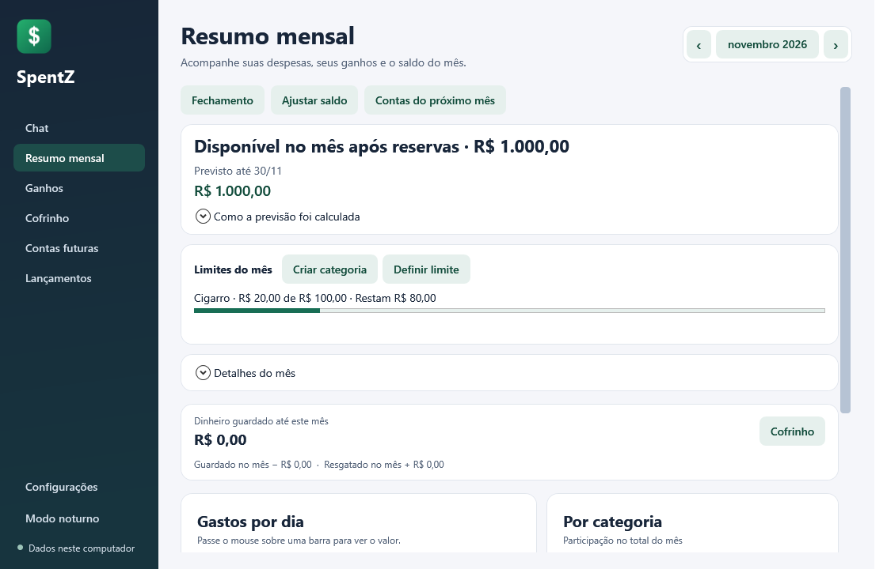
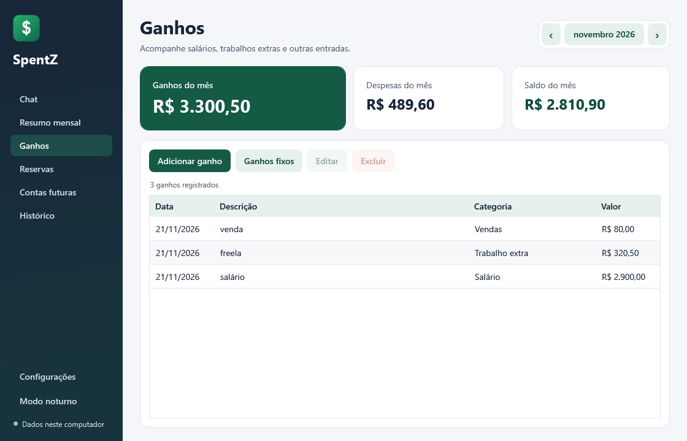
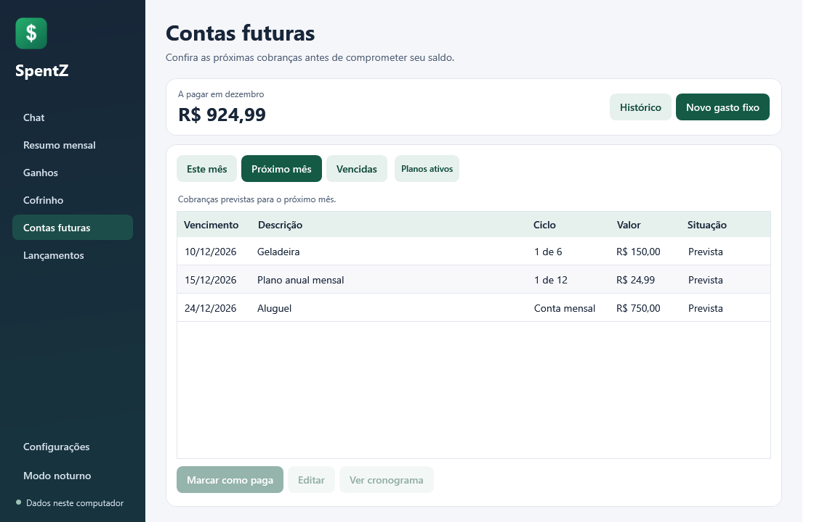

# SpentZ

Aplicativo de controle financeiro pessoal para **Windows 10 e 11**. Registre despesas e ganhos em uma conversa e acompanhe o saldo do mês, as contas futuras e o dinheiro reservado no Cofrinho.

<a href="https://github.com/jordaozz/SpentZ/releases/latest/download/SpentZ.exe"></a>

[Guia de uso](docs/guia-de-uso.md) · [Todas as versões](https://github.com/jordaozz/SpentZ/releases)



## O que o app faz

- **Registra por chat.** Digite `42,90 almoço` ou `recebi 150 freela` para criar uma despesa ou um ganho. A confirmação permite editar e desfazer.
- **Mostra saldo e previsão.** Consulte movimentações registradas, entradas recorrentes, contas futuras e limites por categoria. O saldo inicial acompanha os meses sem entrar como ganho.
- **Organiza pagamentos e reservas.** Confirme recebimentos, vincule cobranças a lançamentos, registre estornos e movimente valores no Cofrinho.
- **Fecha e exporta o mês.** Confira totais, reservas e cobranças no fechamento e exporte relatórios em CSV.

| Ganhos e recebimentos | Agenda de contas |
| --- | --- |
|  |  |

## Instalação e dados

Baixe `SpentZ.exe` nos [Downloads](https://github.com/jordaozz/SpentZ/releases) e abra no Windows. O app funciona offline. Os registros ficam no banco SQLite local em `%LOCALAPPDATA%\GastoEmDia\gastos.sqlite3`. Em **Configurações → Backup e restauração**, salve ou restaure uma cópia dos dados e das preferências.

## Desenvolvimento

O SpentZ usa **C#, WPF e SQLite**. O aplicativo utiliza o componente SQLite do Windows. A interface está em `Main.xaml`, a interpretação dos lançamentos e o acesso ao banco em `Ledger.cs`, e as cobranças e conciliações em `Billing.cs` e `Reconciliation.cs`.

Na raiz do projeto, compile e rode a verificação pelo PowerShell. A verificação usa bancos descartáveis com dados de teste.

```powershell
.\build.ps1
$qa = Start-Process .\SpentZ.exe -ArgumentList '--self-test', '.\work\verificacao' -Wait -PassThru -WindowStyle Hidden
Get-Content .\work\verificacao\resultado.txt
$qa.ExitCode
```

O [guia de uso](docs/guia-de-uso.md) detalha os fluxos e as referências de produto. As imagens acima usam dados de demonstração.
