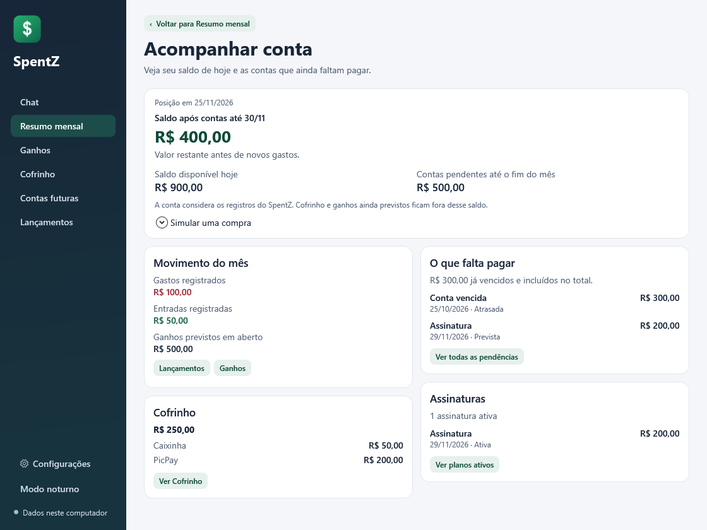
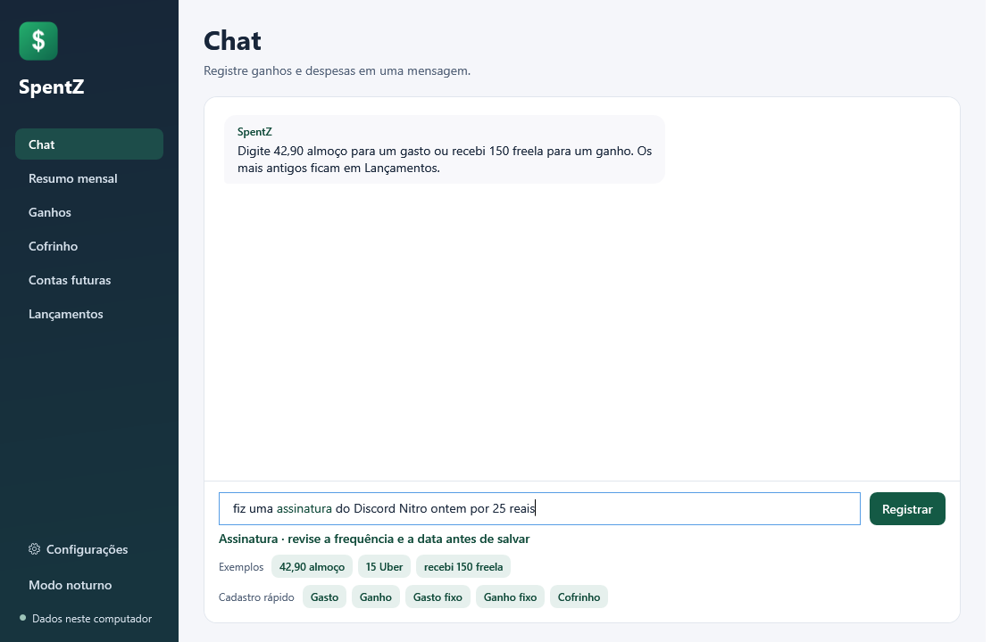
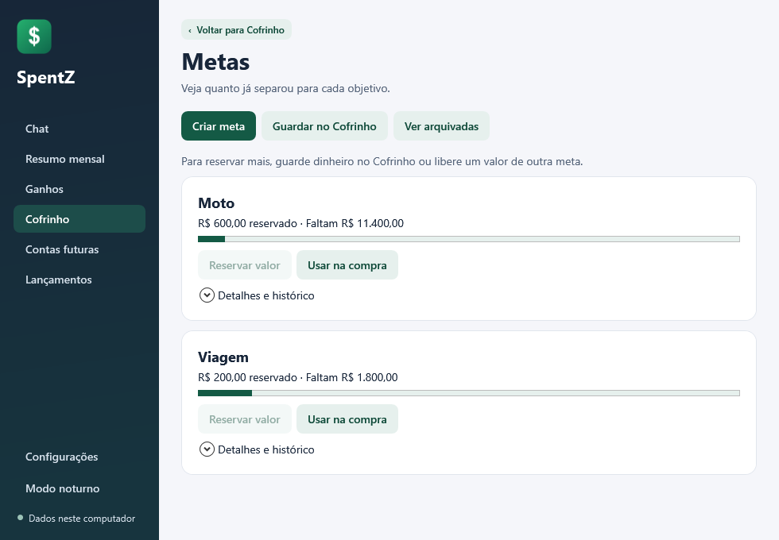

# SpentZ

Controle financeiro pessoal gratuito para **Windows**. Registre gastos e ganhos pelo chat, acompanhe assinaturas e saiba quanto sobra depois das contas do mês.

<a href="https://github.com/jordaozz/SpentZ/releases/latest/download/SpentZ.exe"></a>

[Guia de uso](docs/guia-de-uso.md) · [Todas as versões](https://github.com/jordaozz/SpentZ/releases)



## O que você pode fazer

| No SpentZ | Como usar |
| --- | --- |
| **Registrar pelo chat** | Digite `42,90 almoço` ou `ganhei 150 de um freela`. O app destaca o tipo enquanto você escreve. |
| **Planejar contas e assinaturas** | Digite `25 assinatura do Discord Nitro` para revisar a frequência e as datas. Consulte as cobranças do mês, as vencidas e as próximas renovações. |
| **Acompanhar conta** | Veja o saldo de hoje, os ganhos previstos e quanto sobra depois das pendências. Simule uma compra para conhecer o impacto no saldo. |
| **Organizar metas e limites** | Separe o valor do Cofrinho por objetivos, mesmo quando o dinheiro está no mesmo banco. Defina um limite mensal para cada categoria. |
| **Revisar o mês** | Corrija lançamentos, compare os fechamentos e exporte relatórios em CSV. |

| Chat reconhecendo uma assinatura | Metas do Cofrinho |
| --- | --- |
|  |  |

## Como começar

1. Abra `SpentZ.exe` no Windows 10 ou 11.
2. Informe quanto você tem disponível hoje. Se já tinha dinheiro separado, cadastre-o em **Cofrinho → Já tinha guardado**.
3. Registre uma movimentação no **Chat** e abra **Resumo mensal → Acompanhar conta** para conferir seu saldo.

O app funciona offline. Em **Configurações → Backup e restauração**, salve uma cópia protegida por senha para recuperar seus registros em outro computador. O banco em uso fica em `%LOCALAPPDATA%\GastoEmDia\gastos.sqlite3`. Os CSVs e o banco local ficam legíveis no computador.

O executável é distribuído sem assinatura digital. O Windows pode pedir confirmação na primeira abertura. O hash SHA-256 está nos arquivos do release. [Como funciona o SmartScreen](https://learn.microsoft.com/windows/apps/package-and-deploy/smartscreen-reputation)

## Compilar e testar

O SpentZ usa **C#, WPF e SQLite do Windows**. Compile com o PowerShell e o .NET Framework do Windows.

```powershell
.\build.ps1
$testDir = Join-Path (Get-Location).Path 'work\verificacao'
$qa = Start-Process -FilePath .\SpentZ.exe -ArgumentList '--self-test', ('"{0}"' -f $testDir) -Wait -PassThru
Get-Content -LiteralPath (Join-Path $testDir 'resultado.txt')
$qa.ExitCode
```

Os testes criam bancos descartáveis com dados fictícios. Uma execução bem-sucedida termina com `OK` e código `0`.

| Arquivo | Responsabilidade |
| --- | --- |
| `Main.xaml` e `Program.cs` | Interface, navegação e fluxo dos registros |
| `ChatIntent.cs` e `Ledger.cs` | Interpretação do chat e gravação dos lançamentos |
| `Billing.cs` e `AccountOverview.cs` | Cobranças, saldos e pendências |
| `Goals.cs` e `PortableBackup.cs` | Metas do Cofrinho e backup protegido |

## Autor

Gabriel Jordão. [GitHub](https://github.com/jordaozz)
